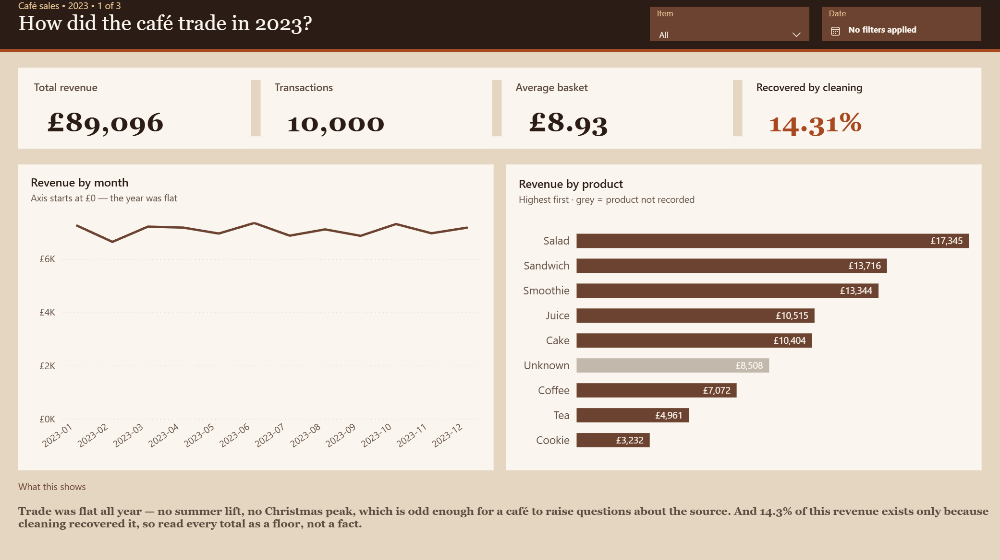
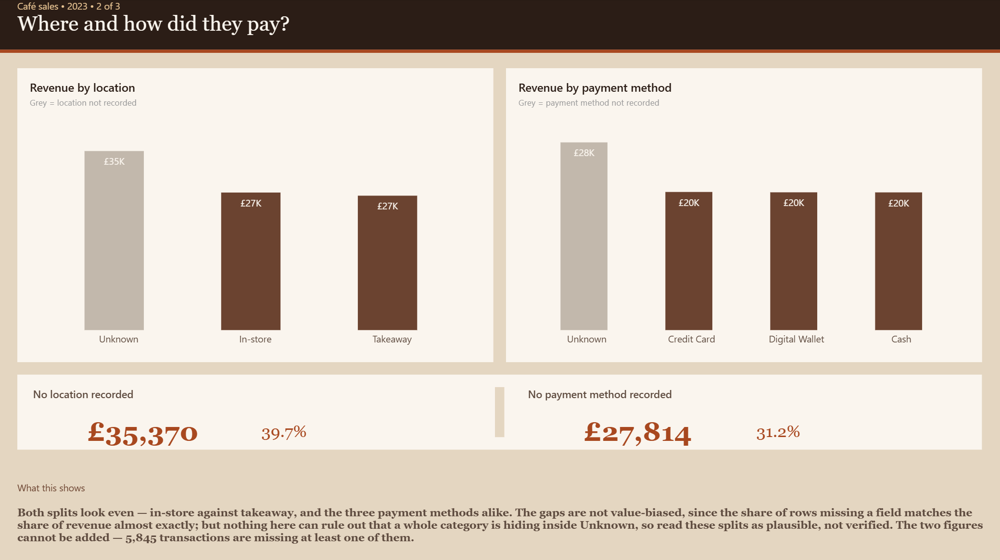
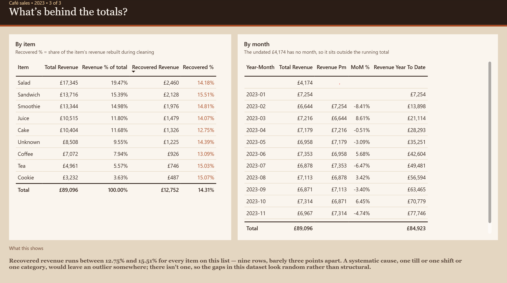

# Cafe Sales — SQL cleaning pipeline and Power BI report

This project cleans a 10,000-row Kaggle dataset of coffee shop transactions ([Cafe Sales — Dirty Data for Cleaning Training](https://www.kaggle.com/datasets/ahmedmohamed2003/cafe-sales-dirty-data-for-cleaning-training)). The raw data contains `ERROR` and `UNKNOWN` placeholders and empty values across every column. I rebuilt it in MySQL as a staging → clean → reporting pipeline, recovered 96.6% of the missing numeric values from relationships within the data, and built a three-page Power BI report on top of it.

The SQL scripts and the `.pbix` are both deliverables. The report is included as source: the theme is a JSON file in this repo, not a set of clicks.

## The data problem

I assessed all eight columns. Every column except `transaction_id` contains `ERROR` and `UNKNOWN` placeholders or empty strings.

| Column | Invalid values | % of rows |
|---|---|---|
| location | 3,961 | 39.6% |
| payment_method | 3,178 | 31.8% |
| item | 969 | 9.7% |
| price_per_unit | 533 | 5.3% |
| total_spent | 502 | 5.0% |
| quantity | 479 | 4.8% |
| transaction_date | 460 | 4.6% |
| transaction_id | 0 | 0% |

Source: `02_profiling.sql` — see `v_dq_column_summary`.

Five columns are damaged below 10%, but `payment_method` and `location` are far worse. For the date column I also checked for malformed values, not just placeholders: `STR_TO_DATE()` fails on exactly the same 460 rows, so there are no impossible dates or alternative formats hiding in there.

The three numeric columns are linked by `total_spent = quantity × price_per_unit`, so missing values there can be derived from the remaining two. The damaged text columns have no such relationship.

## Approach

I built the pipeline in three stages.

First, `stg_cafe` holds the raw data as `VARCHAR`, so the load never fails and never silently changes a value. After the load I validated it: 10,000 rows, 0 warnings. I checked the max length of every column to make sure nothing was truncated.

The second stage is `clean_cafe`, which holds every column in the right data type. Placeholders became `NULL`, dates became `DATE`, money became `DECIMAL`. All cleaning happens here, so the raw layer stays intact and the whole pipeline can be rebuilt from scratch.

I also created `dim_item`, a table holding each item with its price, derived from the clean rows rather than typed in by hand. I set `item` as the primary key, which proves every item appears only once — and therefore has exactly one price.

I left unrecoverable values as `NULL`, which means "not known". I did not substitute zeros: a zero would be included in an average, a `NULL` is skipped.

The third stage is `06_reporting_views.sql`, added when the report was built. It is covered under [Reporting layer](#reporting-layer) below.

## Recovery

The three numeric columns are linked by `total_spent = quantity × price_per_unit`. I verified this on every row where all three values are present: zero exceptions. Where exactly one value was missing, I calculated it from the other two.

Where the price itself was missing but the item was known, I filled it from `dim_item`. That unlocked a further 32 rows: once the price was known, the missing quantity or total could also be calculated.

This recovered 1,430 rows — 96.6% of the 1,514 missing numeric values. The remaining 52 are rows where two of the three values are missing, so nothing can be derived.

### Validation

| Check | Result |
|---|---|
| Row count | 10,000 |
| Rows repaired (`SUM(is_recovered)`) | 1,430 |
| `quantity × price_per_unit <> total_spent` | 0 rows |
| `is_recovered` nulls | 0 |

Remaining nulls: item 969, quantity 23, price_per_unit 6, total_spent 23, payment_method 3,178, location 3,961, transaction_date 460.

The numbers reconcile from both directions: 479 + 533 + 502 = 1,514 missing values, of which 52 remain — and those 52 are exactly the two missing fields in each of the 26 rows that had two gaps.

Every repaired row carries `is_recovered = 1`, so a calculated value can always be told apart from a recorded one.

## What I did not do

Some values cannot be recovered, and I left them as `NULL` rather than guess.

**Item.** Each product has one price, so the price can always be derived from the item. The reverse only works where the price is unique: 1.00, 1.50, 2.00 and 5.00 identify exactly one product, but 3.00 could be Juice or Cake, and 4.00 could be Smoothie or Sandwich. I did not guess those.

**Transaction date.** 460 dates are missing. `transaction_id` is a random seven-digit number, not a sequence, so the rows cannot be ordered in time and a missing date cannot be interpolated from its neighbours.

**Payment method and location.** No other column predicts them. These are lost: 3,178 and 3,961 rows.

For `location` I checked whether the missing rows are biased: the average basket of the unknown group (8.95) sits between the two known groups (8.80 and 9.03), so the gap appears random. For `payment_method` the same check is less clean — the unknown group's average basket (8.78) sits slightly below all three known methods (8.93–9.05). The gap is about 2% and close to what random variation produces at this sample size, but conclusions about the payment mix should be read with that caveat.

## Findings

- **Coffee sells the most units (3,536) but earns 7,072 — less than half of Salad's 17,345.** Salad sells fewer units and earns 2.5 times more. A decision based on units sold would back the wrong product.
- **An average Salad transaction is worth 15.10; a Cookie transaction 2.95.**
- **No seasonality.** Daily average revenue by month ranges from 221.85 to 245.10 — under 10%. In raw monthly totals February looks like the worst month (−8.4%), but that is the 28-day effect; normalised to a daily average it is +1.4% and the third best month.
- **No weekly pattern.** Daily average revenue ranges from 224.63 (Wednesday) to 238.49 (Thursday), a spread of 6.2%. 2023 contains 53 Sundays and 52 of every other weekday, so this is measured per day, not per weekday total.
- **Location does not affect spending.** In-store 9.03 vs takeaway 8.80 per transaction, with an identical basket size of about 3 units.
- **The three known payment methods split evenly:** 22.90%, 22.91% and 22.97% of revenue.

Unattributable revenue: 9.5% has no item, 4.7% has no date.

## Is this data real?

Four independent signals say it is generated rather than collected:

1. Damage is spread randomly across columns. 3,089 rows are fully intact, which matches what independent random corruption predicts (~3,000).
2. No seasonality — monthly daily averages vary by under 10%.
3. No weekly pattern — weekday daily averages vary by 6.2%.
4. In-store and takeaway split 3,017 to 3,022.

A real coffee shop would show a weekend effect at least. This does not make the dataset less useful for practising data cleaning, but it rules out drawing business conclusions from the patterns — because there are none.

---

## Reporting layer

`06_reporting_views.sql` sits between the cleansed tables and Power BI. It adds two views and changes no data.

The rule it enforces: **`clean_cafe` keeps `NULL` where a value is genuinely missing. `'Unknown'` is a reporting label, created in the view layer and nowhere else.** The cleansed layer never pretends to know something it doesn't, and the report can still draw the gap as a visible category.

| View | What it does |
|---|---|
| `v_cafe_sales` | The fact view. `COALESCE` to `'Unknown'` on the three text columns that can be missing. |
| `v_dim_item` | The dimension view. `dim_item` plus an `'Unknown'` row added with `UNION ALL`. |

Two details worth stating:

**`COALESCE` is applied to text columns only.** On a numeric or date column it coerces the type and destroys the aggregation — `SUM`, the date hierarchy and every time intelligence measure would break. `transaction_date` therefore keeps its `NULL`s.

**`dim_item` cannot hold the `'Unknown'` row itself.** `price_per_unit` is `NOT NULL` and constrained to be positive, and an unidentified product has no price. Those constraints are correct, so the label is added in the view instead. Without that row, Power BI silently routes the unmatched fact rows to an auto-generated blank row.

Power BI connects through a read-only service account scoped to this schema — never the root account. The grant is documented at the end of `06_reporting_views.sql`.

## Power BI report

Three pages, each answering one question. `powerbi/cafe_sales.pbix`.

### 1 — How did the café trade in 2023?

> Trade was flat all year — no summer lift, no Christmas peak, which is odd enough for a café to raise questions about the source. And 14.3% of this revenue exists only because cleaning recovered it, so read every total as a floor, not a fact.

### 2 — Where and how did they pay?

> Both splits look even — in-store against takeaway, and the three payment methods alike. The gaps are not value-biased, since the share of rows missing a field matches the share of revenue almost exactly; but nothing here can rule out that a whole category is hiding inside Unknown, so read these splits as plausible, not verified. The two figures cannot be added — 5,845 transactions are missing at least one of them.

### 3 — What's behind the totals?

> Recovered revenue runs between 12.75% and 15.51% for every item on this list — nine rows, barely three points apart. A systematic cause, one till or one shift or one category, would leave an outlier somewhere; there isn't one, so the gaps in this dataset look random rather than structural.

### How it is built

A star schema over the two reporting views: `v_cafe_sales` as the fact table, `v_dim_item` and a `CALENDARAUTO()` date table as dimensions. Sixteen DAX measures live in a separate `_Measures` table, including `CALCULATE` with `ALL` for share-of-total, `PREVIOUSMONTH` for month on month, and `DATESYTD` for the running total.

Filters and groupings come from the dimensions, never from the fact table. That is what makes `ALL('dim_item'[ITEM])` work: the filter originates in the dimension, so that is the only place it can be removed. `ALL('clean_cafe'[ITEM])` returns 100% without raising an error — a wrong answer that looks right.

### Two decisions worth defending

**`Unknown` is shown, not filtered out.** It is the tallest bar on both charts on page 2. Hiding it would make the report look cleaner and say something false: that the splits are measured. They are measured across 60% and 69% of the revenue. The grey tells the reader which bar is a gap rather than a category.

**The undated £4,174 stays visible.** It has no month, so it cannot sit inside a running total — which is why the page 3 total (£89,096) does not match the year-to-date column (£84,923). The subtitle says so. Filtering the row out would make the two numbers agree and lose £4,174 without telling anyone.

### Colour rule

| Colour | Meaning |
|---|---|
| Roast `#6B4330` | recorded data |
| Ash `#C2B8AC` | a gap, not a category — used only for `Unknown` |
| Burnt caramel `#A8481F` | anything about how far to trust the number |

Everything else is background and text. The palette is in `powerbi/cafe-2023-roast-theme.json`.

## Files

| File | What it does |
|---|---|
| `sql/01_staging_load.sql` | Creates the schema and `stg_cafe`, loads the CSV, validates the load |
| `sql/02_profiling.sql` | Column-level damage: `v_dq_column_summary` (totals per column) and `v_dq_issue_detail` (which placeholder, how many times) |
| `sql/03_clean.sql` | Row-level damage: `v_dq_pct_report` (how many fields are missing per row) and `v_dq_fixable` (how many rows are recoverable) |
| `sql/04_clean_cafe.sql` | Builds `clean_cafe` and `dim_item`, runs the recovery, validates the result |
| `sql/05_analysis.sql` | The five analysis queries behind the findings above |
| `sql/06_reporting_views.sql` | `v_cafe_sales` and `v_dim_item` — the layer Power BI connects to |
| `powerbi/cafe_sales.pbix` | The three-page report |
| `powerbi/cafe-2023-roast-theme.json` | The report theme: palette, fonts, default visual styles |
| `data/dirty_cafe_sales.csv` | The raw Kaggle file, so the pipeline runs end to end |

Run the SQL in order. Each script drops and recreates what it builds, so the whole pipeline can be rebuilt from the raw CSV at any time.

**Requirements:** MySQL 8.0.16 or later (`CHECK` constraints are not enforced before that). `LOAD DATA LOCAL INFILE` needs `local_infile` enabled on the server and `OPT_LOCAL_INFILE=1` in the Workbench connection. Power BI Desktop for the `.pbix`; the file contains the imported data, so it opens without a database connection.
